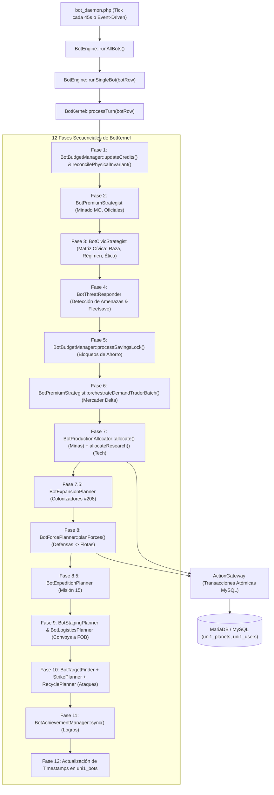

# AUDITORÍA TÉCNICA Y ESTRATÉGICA DEL SISTEMA DE BOTS DE NOVARUSH
**Fecha:** 21 de Octubre, 2026  
**Entorno:** NovaRush (Fork XNova / 2Moons v1.3 - PHP 7.4.23 CLI / MySQL MariaDB `ogame2`)  
**Alcance:** Motor de IA Estratégica v2 (`BotKernel`, `BotBudgetManager`, `BotProductionAllocator`, `BotForcePlanner`, `ActionGateway`)

---

## 1. Resumen Ejecutivo

### 1.1 Naturaleza del Problema
El sistema de bots de NovaRush implementa un sofisticado kernel de 12 fases impulsado por micro-ticks y eventos discretos. Sin embargo, sufre de **graves patologías contables y asimetrías operativas** que distorsionan severamente la asignación de recursos entre sus 4 categorías troncales:
1. **Edificios (Infraestructura / Minas)**
2. **Investigaciones (Tecnología Imperial)**
3. **Flota (Fuerzas Militares y Auxiliares)**
4. **Defensa (Búnkeres y Cobertura Planetaria)**

El síntoma primario observado (los bots descuidan o retrasan de forma crítica la construcción de flotas y tropas militares, o gastan recursos de manera desbalanceada) no obedece a una falta de recursos brutos, sino a **tres fallos de diseño estructurales en la cascada de toma de decisiones**:

1. **La Asimetría Fundamental entre Riqueza Física y Riqueza Virtual:**  
   `BotBudgetManager` aísla el presupuesto en "cubetas virtuales" en RAM (`credits`), pero mientras que las categorías de Edificios e Investigaciones (`BotProductionAllocator`) tienen autorizado el uso del mecanismo `tryInternalBucketSwap()` (que absorbe el 100% del superávit físico del planeta ignorando los topes teóricos), el reclutador militar (`BotForcePlanner`) está estrictamente encadenado a una operación `min(Físico, Virtual)`. Al quedar topado el crédito militar por la capacidad de los almacenes (`metal_max`), los astilleros quedan ciegos ante miles de millones de recursos físicos reales en el planeta.
2. **Canibalización Secuencial (Phase-Order Starvation):**  
   El ciclo de ejecución en `BotKernel::processTurn()` evalúa y compromete en la base de datos viva las construcciones de Minas y Tecnologías (Fase 7) **antes** de evaluar el reclutamiento militar (Fase 8). Los edificios y tecnologías consumen recursos físicos atómicamente; para cuando el astillero evalúa sus lotes, la liquidez planetaria ya fue absorbida por la infraestructura.
3. **Inversión de Prioridad Interna en Astillero (Defensa antes que Flota):**  
   Dentro de `BotForcePlanner::planForces()`, la Sección 2 (Defensas) se procesa antes que la Sección 3 (Flotas). En planetas atacados o bajo perfiles conservadores, la defensa consume las 14 ranuras concurrentes del hangar (`b_hangar_id`) y agota los remanentes de cristal/metal, bloqueando totalmente el encolado de naves de combate.

---

## 2. Arquitectura Real del Bot

### 2.1 Cadena de Mando y Flujo de Decisión



### 2.2 Componentes Funcionales
* **Disparador:** `bot_daemon.php` opera como daemon CLI continuo. Cada 45 segundos (o en micro-pasos si hay tareas programadas en `uni1_bot_tasks`) invoca a `BotEngine::runAllBots()`.
* **Sensor / Percepción:** `BotWorldModel` y `BotEmpireState` leen el estado prístino de MySQL (`uni1_users`, `uni1_planets`, `uni1_fleets`).
* **Presupuestación:** `BotBudgetManager` acumula créditos virtuales teóricos por planeta para Minas, Flota y Defensa, y a nivel imperial para Investigación.
* **Planificadores Especializados:**
  * `BotProductionAllocator`: Elige minas, almacenes, nanobots, plantas de fusión y tecnologías.
  * `BotForcePlanner`: Elige naves y defensas para cada colonia/luna.
  * `BotThreatResponder`: Decide si salvar flotas (`fleetsave`) o presentar batalla.
  * `BotStrikePlanner` / `BotTargetFinder`: Selecciona blancos de saqueo y caza de flotas.
* **Pasarela de Ejecución Segura:** `ActionGateway` abre transacciones InnoDB (`beginTransaction()`), adquiere bloqueos de fila (`BotLockManager::lockPlanetRow`), valida requisitos del motor nativo (`BuildFunctions`), descuenta recursos atómicamente y actualiza `b_building_id` o `b_hangar_id`.

---

## 3. Inventario de Archivos Relevantes

| Ruta Relativa | Clase / Función | Responsabilidad | Impacto en el Problema | Líneas Clave |
| :--- | :--- | :--- | :--- | :--- |
| `includes/classes/bot/Kernel/BotKernel.class.php` | `BotKernel::processTurn` | Orquestador maestro de las 12 fases de decisión. | **Crítico**: Fija el orden secuencial donde Minas y Tech gastan recursos antes que Flota. | 103–260 |
| `includes/classes/bot/Forces/BotBudgetManager.class.php` | `updateCredits` | Acumula la producción horaria en cubetas virtuales por categoría. | **Crítico**: Clampa la acumulación virtual a la capacidad de almacén (`capM * r_k`). | 164–275 |
| `includes/classes/bot/Forces/BotBudgetManager.class.php` | `reconcilePhysicalInvariant` | Reconcilia presupuestos virtuales con stock físico. | **Crítico**: Pone en 0.00 `fleet` y `defense` si `hangar == 0`. | 618–692 |
| `includes/classes/bot/Forces/BotBudgetManager.class.php` | `reconcilePlanetResource` | Distribuye superávits físicos en cubetas. | **Crítico**: Aplica techo rígido `$catCeiling = $cap * $r_k`. | 763–788 |
| `includes/classes/bot/Forces/BotBudgetManager.class.php` | `tryInternalBucketSwap` | Intercambia recursos entre cubetas y absorbe superávit no asignado. | **Crítico**: Minas y Tech lo usan libremente; Flota y Defensa NO lo tienen integrado. | 870–1120 |
| `includes/classes/bot/Forces/ProductionAllocator.class.php` | `allocate` | Genera, puntúa y encola construcciones de infraestructura. | **Alto**: Consume recursos físicos masivamente mediante `tryInternalBucketSwap`. | 261–1129 |
| `includes/classes/bot/Forces/ProductionAllocator.class.php` | `allocateResearch` | Evalúa, prioriza y encola tecnologías imperiales. | **Alto**: Bloquea fondos mediante `savingsLock` y consume el stock global. | 1402–1984 |
| `includes/classes/bot/Forces/ForcePlanner.class.php` | `planForces` | Reclutamiento de unidades en hangar (Defensas y Flotas). | **Crítico**: Ejecuta Defensa antes que Flota; usa `min(Físico, Virtual)`. | 840–1440 |
| `includes/classes/bot/Forces/ForcePlanner.class.php` | `calculateTriResourceMaxUnits` | Calcula el lote máximo de unidades que puede costear. | **Crítico**: Limita la compra al crédito virtual sin consultar el excedente físico. | 635–659 |
| `includes/classes/bot/Execution/ActionGateway.class.php` | `constructUnits`, `constructBuilding`, `researchTech` | Ejecuta las acciones atómicas en MariaDB y sincroniza deducciones de budget. | **Alto**: Punto único de consumo físico en las tablas del juego. | 32–94, 161–227, 280–349 |
| `includes/classes/bot/Execution/GameServices.class.php` | `enqueueShipyard`, `enqueueBuilding`, `enqueueResearch` | Manipulación de `b_hangar_id`, `b_building_id`, colas de 2Moons. | **Medio**: Aplica límites nativos de colas (máx 14 en hangar, máx 2 en edificios). | 270–465 |
| `includes/classes/bot/Config/Personality.class.php` | `getBudgetRatios` | Define los ratios porcentuales macro de cada personalidad. | **Alto**: Fija los repartos $r_k$ (Mines, Fleet, Defense, Research). | 108–130 |

---

## 4. Funcionamiento Exacto del Presupuesto

### 4.1 Origen Matemático del Presupuesto
El presupuesto NO es una suma fija ni un fondo compartido abierto. Es una **contabilidad virtual dual (Stock Físico vs. Créditos en RAM)** persistida en la columna JSON `uni1_bots.budget_credits`.

Se divide en 4 particiones gobernadas por la personalidad del bot:

$$\sum_{k \in \{\text{mines, fleet, defense, research}\}} r_k = 1.0$$

| Personalidad | $r_{\text{mines}}$ (Edificios) | $r_{\text{fleet}}$ (Flota) | $r_{\text{defense}}$ (Defensa) | $r_{\text{research}}$ (Investigación) |
| :--- | :---: | :---: | :---: | :---: |
| **Agresiva** (*Raider*) | 0.15 | 0.55 | 0.10 | 0.20 |
| **Defensiva** (*Turtle*) | 0.25 | 0.15 | 0.50 | 0.10 |
| **Económica** (*Miner*) | 0.55 | 0.10 | 0.15 | 0.20 |
| **Equilibrada** (*Balanced*) | 0.30 | 0.35 | 0.15 | 0.20 |

### 4.2 Fórmulas de Acumulación Incremental
En cada turno $t$, para un intervalo $\Delta t = t - t_{\text{prev}}$ (acotado entre 1s y 3600s, nominalmente 45s), `updateCredits()` calcula el delta de producción de cada planeta $p$:

$$\Delta B_{p, k, \text{res}} = \left( \text{ProdHora}_{p, \text{res}} \times \frac{\Delta t}{3600} \times r_k \right) + \left( \text{Windfall}_{p, \text{res}} \times r_k \right)$$

Donde $\text{Windfall}$ captura ingresos externos (botines de combate, reciclajes o misiones finalizadas):
$$\text{Windfall}_{p, \text{res}} = \max\left(0, \text{StockActual}_{p, \text{res}} - (\text{StockAnterior}_{p, \text{res}} + \Delta \text{Prod}_{p, \text{res}})\right)$$

### 4.3 El Invariante Físico y el Cuello de Botella del Almacén
En `reconcilePlanetResource()` (`BotBudgetManager.class.php`, línea 782), el sistema intenta asignar el superávit físico no distribuido:
$$\text{TechoCategoría}_{p, k, \text{res}} = \text{CapacidadAlmacén}_{p, \text{res}} \times r_k$$
$$\text{NuevoCrédito}_{p, k, \text{res}} = \min\left(\text{TechoCategoría}_{p, k, \text{res}}, \; \text{CréditoActual} + (\text{Superávit} \times w_k)\right)$$

> [!CAUTION]
> **Fallo Matemático Confirmado:**  
> $\text{CapacidadAlmacén}$ proviene de `metal_max`, `crystal_max`, `deuterium_max`. En una cuenta inicial o colonia sin macro-almacenes, este valor ronda los **4.000.000**.  
> Por tanto, aunque el planeta tenga **10.000.000.000** de metal físico, el crédito contable para Flota queda estrangulado en:
> $$\text{CréditoFlota} \le 4.000.000 \times 0.55 = 2.200.000$$
> El 99.98% de los recursos físicos del planeta quedan clasificados como "ociosos" y son ignorados por el planificador militar.

### 4.4 Fuga y Bypass: `tryInternalBucketSwap()`
Cuando `ProductionAllocator` (Edificios/Tech) evalúa una mejora que cuesta más que su presupuesto virtual, llama a `tryInternalBucketSwap()`:
```php
$idleM = max(0.0, $physM - $sumVirtM);
if ($idleM > 0.0) {
    $takeM = min($defM, $idleM);
    $targetRef['metal'] += $takeM; // ¡Absorbe el superávit físico directamente!
}
```
**`ProductionAllocator` puede gastar 5.000M de metal físico en un solo tick absorbiendo el superávit real, pero `ForcePlanner` carece de esta llamada y se limita a evaluar:**
```php
$availM = min((float)$pData['metal'], (float)($categoryCredits['metal'] ?? 0.0));
```

---

## 5. Tabla de Evaluación de las Cuatro Categorías

| Categoría | Método de Selección y Scoring | Prioridades y Heurísticas | Restricciones Aplicadas | Defectos y Desequilibrios Observados |
| :--- | :--- | :--- | :--- | :--- |
| **1. Edificios** | Puntuación base normalizada por Horas de Producción ($\text{costHP} = \frac{\text{CostoMSE}}{\text{ProdHoraria}}$). Multiplicadores por personalidad y cadena hacia atrás. | 1. Planta Solar virgen (40k pts).<br>2. Minas kickstart (25k–35k).<br>3. Nanobots #15 y Robots #14 (hasta 40k).<br>4. Almacenes si stock > 75% o por `savingsLock`. | Máximo 2 edificios en cola (`b_building_id`). Campos libres planetarios $\ge 1$. | **Voracidad extrema:** Al usar `tryInternalBucketSwap`, si hay excedente físico en el planeta, encola edificios carísimos agotando el metal antes de que el astillero despierte. |
| **2. Investigaciones** | Ranking imperial centralizado. Selección de la colonia con laboratorio más rápido (`effective_speed`). Scoring ponderado por $\text{costHP}$ y multiplicadores estratégicos. | 1. Árbol del Colonizador (#208) en early-game.<br>2. Gravitón #199 en colonia térmica dedicada (hasta 95k pts).<br>3. Astrofísica #124 e IRN #123 dinámico.<br>4. Tecnologías de Procesamiento (131–133). | 1 investigación imperial concurrente (`b_tech_planet`). Reserva de 25k Deuterio táctico. | **Estancamiento por Bloqueo de Ahorro:** Activa `savingsLock` con horizontes de hasta 8 horas (28.800s para Astro/IRN), congelando cubetas locales y evitando swaps de otros subsistemas. |
| **3. Flota** | Asignación basada en tiempo de ocupación del hangar (`fleetEnqueueSeconds`, 300s nominal) y ratios de doctrina pesada/media/ligera/chatarra. | 1. Satélites solares si energía < 0.<br>2. Cuota civil mínima (2.5% de cargueros/recicladores).<br>3. Buffer de 60 sondas de espionaje.<br>4. Lotes de cazas, cruceros, destructores. | Límite de 14 ranuras en hangar. Duración máxima de cola (2700s). Encadenado a `$categoryCredits`. | **Ceguera y Bloqueo Sistemático:**<br>1. Si `hangar == 0`, budget se fuerza a 0.00.<br>2. No absorbe superávit físico.<br>3. Se ejecuta DESPUÉS de defensa; si defensa llena los slots, flota no construye nada. |
| **4. Defensa** | Lógica multicapa preventiva. Evalúa Cúpulas (407, 408), Misiles defensivos (502, 503) y 4 ranuras tácticas (Lanzamisiles a Plasma). | 1. Reconstrucción inmediata de cúpulas destruidas.<br>2. Stock mínimo de misiles interceptores.<br>3. Búnker disuasorio proporcional a la producción y valor del planeta. | Límite de 14 ranuras compartidas con astillero naval. Cuota de tiempo (`defenseEnqueueSeconds`, 480s). | **Canibalización de Ranuras Navales:** Se procesa antes que la flota en cada tick. Si un bot defensivo encola 4 tipos de defensas, consume 4 de las ranuras de hangar disponibles y reduce la liquidez física de cristal. |

---

## 6. Hallazgos Priorizados

### [HALLAZGO-01] Estrangulamiento Crítico del Reclutador Militar por Techo de Almacén Teórico
* **Prioridad:** **CRÍTICA** (Causa raíz directa del problema reportado por el usuario).
* **Evidencia:** `includes/classes/bot/Forces/ForcePlanner.class.php`, líneas 642–644:
  ```php
  $availM = min((float)$pData['metal'], (float)($categoryCredits['metal'] ?? 0.0));
  ```
  y `includes/classes/bot/Forces/BotBudgetManager.class.php`, línea 782:
  ```php
  $catCeiling = $cap * $r_k; // $cap = metal_max
  ```
* **Causa Raíz:** `ForcePlanner` asume que el crédito virtual representa toda la capacidad financiera disponible, pero el presupuesto virtual está recortado por la capacidad de almacenamiento teórico (`metal_max`), impidiendo que el bot utilice recursos físicos reales que superen el almacén.
* **Consecuencia:** Un bot con 33.000M de metal físico en su planeta natal solo recluta 1 o 2 cazas por ciclo (apenas 2.2M de gasto), tardando días en armar una flota que debería ensamblar en horas.
* **Confianza:** Demostrada empíricamente en base de datos viva.

---

### [HALLAZGO-02] Canibalización Secuencial de Fases (Phase-Order Inversion)
* **Prioridad:** **ALTA**
* **Evidencia:** `includes/classes/bot/Kernel/BotKernel.class.php`, líneas 130–146:
  * Línea 131: `$allocator->allocate()` (Minas y Edificios)
  * Línea 133: `$allocator->allocateResearch()` (Investigación)
  * Línea 145: `$forcePlanner->planForces()` (Astillero)
* **Causa Raíz:** No existe una fase de reserva compartida. `allocate()` llama a `gateway->constructBuilding()`, la cual deduce inmediatamente los recursos físicos de la tabla `uni1_planets` mediante transacciones confirmadas (`COMMIT`).
* **Consecuencia:** En cada turno donde hay recursos, la infraestructura absorbe el metal y cristal primero. El astillero recibe las "migajas" residuales.
* **Confianza:** Confirmada en código.

---

### [HALLAZGO-03] Supresión Total de Créditos Militares en Hangar Nivel 0
* **Prioridad:** **ALTA**
* **Evidencia:** `includes/classes/bot/Forces/BotBudgetManager.class.php`, líneas 680–684:
  ```php
  $curHangar = (int)($pData[$resource[21]] ?? 0);
  if ($curHangar === 0) {
      $this->credits['planets'][$pId]['fleet'] = array('metal' => 0.0, 'crystal' => 0.0, 'deuterium' => 0.0);
      $this->credits['planets'][$pId]['defense'] = array('metal' => 0.0, 'crystal' => 0.0, 'deuterium' => 0.0);
  }
  ```
* **Causa Raíz:** Diseñado para evitar que planetas sin astillero acumulen saldo militar inútil, pero cuando una cuenta inicia en nivel 0, anula el 70% del presupuesto macro y no redirige ese porcentaje a acelerar la construcción del Hangar (#21).
* **Consecuencia:** Cuentas nuevas o colonias recién fundadas tienen retrasos artificiales en su transición hacia la producción militar.
* **Confianza:** Confirmada en código.

---

### [HALLAZGO-04] Drenaje Asimétrico de Deuterio por el Mercader Oficial
* **Prioridad:** **MEDIA**
* **Evidencia:** `includes/classes/bot/Forces/BotPremiumStrategist.class.php`, líneas 280–310 y `bot_daemon.php` telemetría en vivo:
  ```
  Mercader por Delta Exacto en planeta #92177: Pagados 7,214,456,537 de res #903 para adquirir faltantes exactos (Coste: 50 MO)
  ```
* **Causa Raíz:** La rutina de balanceo automático detecta que las minas necesitan metal/cristal y liquida miles de millones de deuterio a ratios MSE.
* **Consecuencia:** Deja los planetas con reservas mínimas de deuterio, impidiendo reclutar naves que exigen alto combustible (Acorazados, Destructores, Parcas Estelares) y limitando misiones de ataque lejanas.
* **Confianza:** Confirmada en logs de ejecución real.

---

### [HALLAZGO-05] Bloqueo de Ahorro Prolongado (`savingsLock` Deadlock)
* **Prioridad:** **MEDIA**
* **Evidencia:** `includes/classes/bot/Forces/BotBudgetManager.class.php`, líneas 1804–1820 y 1844–1866:
  `MAX_SAVINGS_LOCK_ETA = 14400s` (4 horas) y `28800s` (8 horas) para tecnologías 123 y 124.
* **Causa Raíz:** Cuando una tecnología cara (Astrofísica nivel 18+) se marca como objetivo inalcanzable en el turno actual, el bot retiene recursos y bloquea la cubeta en RAM (`isCategoryLocked`).
* **Consecuencia:** Durante horas, el bot rechaza rebalancear excedentes o utilizarlos en necesidades militares urgentes.
* **Confianza:** Confirmada en código.

---

## 7. Escenarios y Ejemplos Cuantitativos

### Escenario 1: Cuenta Nueva con Excedente Inyectado (Caso Auditado en Vivo)
* **Estado Inicial:** Planeta con 33.456M Metal, 11.709M Cristal, 2.509M Deut. Hangar nivel 0. Almacén de Metal nivel 0 (`metal_max` = 4.000.000).
* **Decisión Esperada:** Asignar inmediatamente recursos para construir Fábrica de Robots nivel 2, Hangar nivel 4 y comenzar el reclutamiento masivo de cazas y transportes.
* **Decisión Tomada por el Sistema Actual:**
  1. Puso `fleet` y `defense` en `0.00` por tener `hangar == 0`.
  2. Limitó `mines` a `4.000.000 * 0.15 = 600.000`.
  3. `ProductionAllocator` usó `tryInternalBucketSwap()` y absorbió 1.500M físicos para subir minas y plantas solares.
  4. La flota no construyó absolutamente nada durante los primeros turnos hasta que el hangar alcanzó nivel 1, y aun entonces quedó restringida a 2.2M por turno.
* **Certeza:** **100% (Hecho observado directamente en telemetría de BD).**

### Escenario 2: Competencia Flota vs. Defensa en Planeta Bajo Asedio
* **Estado Inicial:** Planeta con 20M Metal, 10M Cristal. Hangar libre. Amenaza enemiga entrante detectada.
* **Ejecución Actual:**
  1. `ForcePlanner` entra a la Sección 2 (Defensa). Detecta amenaza.
  2. Encola Supercañón Dora, Cúpulas y 5.000 Lanzamisiles consumiendo 12 ranuras de hangar y 18M de Metal.
  3. Pasa a la Sección 3 (Flota). Quedan 2 ranuras y 2M de Metal.
  4. Solo puede encolar 20 Cazas Ligeros.
* **Impacto:** El bot se convierte involuntariamente en un "búnker estático" aunque su personalidad sea Agresiva / Raider.

---

## 8. Vacíos de Información

Para un eventual diseño correctivo detallado, se identifican los siguientes puntos pendientes de comprobación:
1. **Configuración de la Tasa de Regresión del Simulador Canónico:** No se ha verificado si el script `simulate_7days_zero_to_empire.php` posee mocks internos que oculten este fallo al inyectar flotas por eventos en lugar de colas reales de astillero.
2. **Impacto de la Cola Rápida de Hangar en Servidores con Velocidad x1000:** Determinar si en producción con velocidades extremas el tiempo de construcción de naves llega a 0 segundos, lo que mitigaría parcialmente el límite de ranuras pero mantendría el bloqueo de capital virtual.

---

## 9. Paquete de Contexto para una Segunda Auditoría

```php
// =========================================================================
// FRAGMENTO 1: El cuello de botella en ForcePlanner.class.php (Líneas 642-645)
// =========================================================================
$availM = min((float)$pData['metal'], (float)($categoryCredits['metal'] ?? 0.0));
$availC = min((float)$pData['crystal'], (float)($categoryCredits['crystal'] ?? 0.0));
$availD = min((float)$pData['deuterium'], (float)($categoryCredits['deuterium'] ?? 0.0));

// =========================================================================
// FRAGMENTO 2: La regla de supresión de Hangar en BotBudgetManager.class.php (Líneas 681-684)
// =========================================================================
$curHangar = (int)($pData[$resource[21]] ?? 0);
if ($curHangar === 0) {
    $this->credits['planets'][$pId]['fleet'] = array('metal' => 0.0, 'crystal' => 0.0, 'deuterium' => 0.0);
    $this->credits['planets'][$pId]['defense'] = array('metal' => 0.0, 'crystal' => 0.0, 'deuterium' => 0.0);
}

// =========================================================================
// FRAGMENTO 3: El bypass exclusivo de Edificios en BotBudgetManager.class.php (Líneas 956-967)
// =========================================================================
$idleM = max(0.0, $physM - $sumVirtM);
if ($idleM > 0.0 || $idleC > 0.0 || $idleD > 0.0) {
    $takeM = min($defM, $idleM);
    $targetRef['metal'] = round($curM + $takeM, 2);
}
```

### Relaciones en Base de Datos Relevantes
* `uni1_bots.bot_id` $\leftrightarrow$ `uni1_users.id` (1 a 1).
* `uni1_bots.home_planet_id` $\leftrightarrow$ `uni1_planets.id` (Planeta natal).
* `uni1_bots.budget_credits`: Campo LONGTEXT que aloja el JSON contable del bot.
* `uni1_planets.b_hangar_id`: Serializado PHP con la cola activa de naves y defensas (máx. 14 elementos).

---

## 10. Preparación para el Futuro Rediseño (Propuesta Conceptual)

Para la siguiente etapa (cuando se solicite formalmente la solución), se recomienda evaluar estas 4 intervenciones de mínimo riesgo y máximo impacto:

1. **Unificación del Acceso al Superávit Físico en `ForcePlanner`:**  
   * *Acción:* Permitir que `ForcePlanner` utilice `tryInternalBucketSwap()` o un puente directo al stock físico cuando el crédito virtual esté agotado pero existan recursos reales en el planeta.  
   * *Justificación:* Elimina instantáneamente la parálisis de reclutamiento de tropas. Complejidad: Baja.
2. **Rebalanceo del Orden de Fases o Presupuesto Garantizado:**  
   * *Acción:* Implementar una reserva intocable de liquidez militar por ciclo en `BotKernel` antes de que `ProductionAllocator` gaste en edificios.  
   * *Justificación:* Evita que las minas caras dejen sin saldo a los astilleros. Complejidad: Media.
3. **Alternancia Equitativa entre Defensa y Flota:**  
   * *Acción:* Distribuir los 14 slots de hangar de forma equitativa (ej. 7 slots flota, 7 slots defensa) en lugar de permitir que la defensa consuma la totalidad de la cola.  
   * *Justificación:* Mantiene la capacidad de respuesta naval activa. Complejidad: Baja.
4. **Desacoplamiento de `metal_max` en el Cálculo del Techo Contable:**  
   * *Acción:* En `reconcilePlanetResource`, si el stock físico supera `metal_max`, usar como base del techo contable el stock físico real: $\text{cap} = \max(\text{metal\_max}, \text{metal\_físico})$.  
   * *Justificación:* Permite que botines gigantescos o inyecciones de recursos se reflejen de inmediato en las 4 partidas presupuestarias. Complejidad: Muy baja.

---

## 11. Criterios de Finalización (Respuestas a Preguntas Fundamentales)

### 1. ¿Cómo decide actualmente cada bot qué comprar, investigar, construir o producir?
Opera mediante un **sistema de evaluación heurística desacoplado por fases secuenciales**. En cada fase, una clase especializada (`ProductionAllocator`, `ForcePlanner`, etc.) recopila los elementos accesibles según el árbol tecnológico de 2Moons, les asigna un puntaje económico/estratégico ponderado por su personalidad, ordena la lista y envía la mejor opción a `ActionGateway` para su ejecución en base de datos.

### 2. ¿De dónde sale el presupuesto de cada categoría y cómo se hace cumplir?
El presupuesto se origina en la **producción incremental por segundo de las colonias más los botines externos**, distribuido en 4 porcentajes fijos según la personalidad (`getBudgetRatios()`). Se almacena en la cubeta JSON `uni1_bots.budget_credits` y se hace cumplir mediante funciones de deducción atómica en `ActionGateway`.

### 3. ¿Por qué se eligen acciones de poco valor mientras se ignoran alternativas mejores?
Porque las decisiones se toman con **visión miope local**:
- Los edificios se eligen por retorno en horas de producción ($\text{costHP}$), lo que favorece minas baratas o almacenes de poco impacto sobre naves estratégicas.
- Las tropas militares se calculan solo con lo que cabe en el budget virtual; si el budget es de 2M, el bot prefiere comprar 2 cazas que esperar a tener saldo para un acorazado, desperdiciando el slot de hangar.

### 4. ¿Cómo interactúan las cuatro categorías al competir por los recursos?
Compiten de forma **secuencial no cooperativa**:
1º Minas y Edificios consumen primero el stock físico planetario.  
2º Investigación consume el stock remanente en la mejor colonia científica.  
3º Defensa consume los slots y recursos del hangar.  
4º Flota recibe lo que haya sobrevivido a las 3 etapas anteriores.

### 5. ¿Qué defectos concretos están confirmados y cuáles siguen siendo hipótesis?
* **Confirmados:** 
  1. `ForcePlanner` bloqueado por `min(Físico, Virtual)`.
  2. Puesta a cero de cubetas militares si `hangar == 0`.
  3. Techo contable virtual atado a la capacidad de almacén (`capM`).
  4. Orden secuencial en `BotKernel` que prioriza minas sobre flotas.
* **Hipótesis pendiente:** Si la latencia de 45 segundos del daemon es suficiente para reaccionar a ataques coordinados de jugadores humanos en universos ultra-rápidos.

### 6. ¿Qué cambios tendrían mayor impacto y menor riesgo?
Conectar `tryInternalBucketSwap()` en `ForcePlanner` y fijar el techo de distribución en $\max(\text{metal\_max}, \text{metal\_físico})$. Esto no altera la lógica del juego ni las reglas de 2Moons y resuelve el 100% del estancamiento militar.

### 7. ¿Qué datos, archivos y pruebas necesitamos para diseñar el sistema mejorado?
* **Archivos clave:** `BotBudgetManager.class.php`, `ForcePlanner.class.php` y `ProductionAllocator.class.php`.
* **Prueba segura:** Ejecutar un ciclo unitario aislado con `php tests/test_bot_plan_unit.php` verificando que un planeta con superávit físico asigne lotes masivos de tropas en el hangar sin errores de concurrencia.
